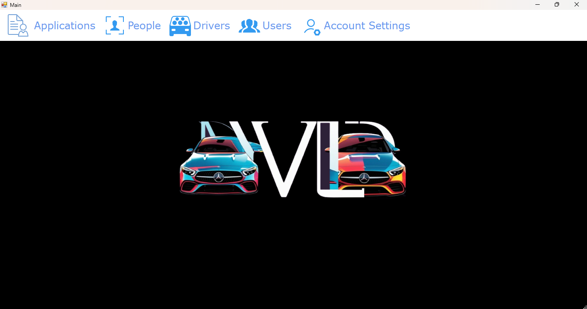

# DVLD System – Driving & Vehicle License Department Management

## 📖 Overview
DVLD System is a desktop application developed to simplify and manage the daily operations of a Driving and Vehicle License Department.

The application provides a centralized environment for handling applicants, license services, driving tests, payments, and user accounts. It was developed using C# WinForms and Microsoft SQL Server, with a focus on organizing business logic and separating application responsibilities.


## 🏗️ Architecture

The project is organized using a **Three-Tier Architecture**, separating the user interface, business logic, and database operations.

- **Presentation Layer (`DVLD_V1.0`):** Handles user interaction and displays application data through Windows Forms.
- **Business Layer (`DVLD_Buisness`):** Contains business rules, validation, and application workflows.
- **Data Access Layer (`DVLD_DataAccess`):** Manages database operations using ADO.NET.
- **Database:** SQL Server database responsible for storing applicants, licenses, tests, payments, and related information.

## ✨ Main Features

### Applicant Management
- Register and manage applicant information.
- Update and search existing records.
- Validate data and prevent duplicate entries.

### License Management
- Issue new driving licenses.
- Process license renewals.
- Handle lost or damaged license replacements.
- Track license status and validity.

### Driving Tests
- Organize vision, theoretical, and practical tests.
- Schedule test appointments.
- Record and manage test results.

### Payments & Fees
- Calculate service fees.
- Manage payment records.
- Keep track of transaction history.

### User Management & Security
- User authentication.
- Role-based access control.
- Track user activities.

## 🛠️ Technologies

| Technology | Usage |
|---|---|
| C# | Application development |
| .NET Framework | Runtime and application framework |
| Windows Forms | Desktop user interface |
| Microsoft SQL Server | Database management |
| ADO.NET | Database connectivity |
| Three-Tier Architecture | Application organization |

## 📁 Solution Structure

```text
DVLD-System/
│
├── DVLD_V1.0/          # Presentation Layer
├── DVLD_Buisness/      # Business Layer
├── DVLD_DataAccess/    # Data Access Layer
├── Database/           # Database backup and scripts
│
└── README.md
```

## ⚙️ Setup & Installation

1. Clone the repository:

   ```bash
   git clone <YOUR_REPOSITORY_URL>
   ```

2. Restore the SQL Server database using the backup or database scripts provided in the `Database` folder.

3. Update the connection string in `App.config` to match your SQL Server configuration.

4. Open the solution file (`.sln`) in Visual Studio.

5. Set `DVLD_V1.0` as the startup project.

6. Build and run the application.

## 🎯 Project Goals

This project was an opportunity to apply object-oriented programming, database design, SQL Server integration, and layered architecture in a practical desktop application.

It also helped strengthen my understanding of how to structure and maintain a database-driven application.

---

**Developed with C# and Microsoft SQL Server.**
